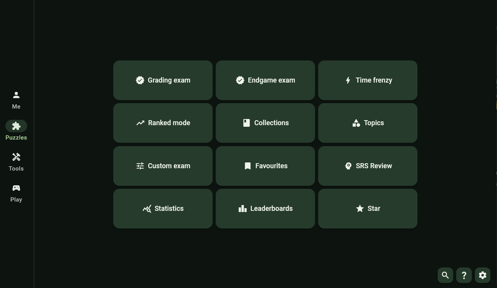
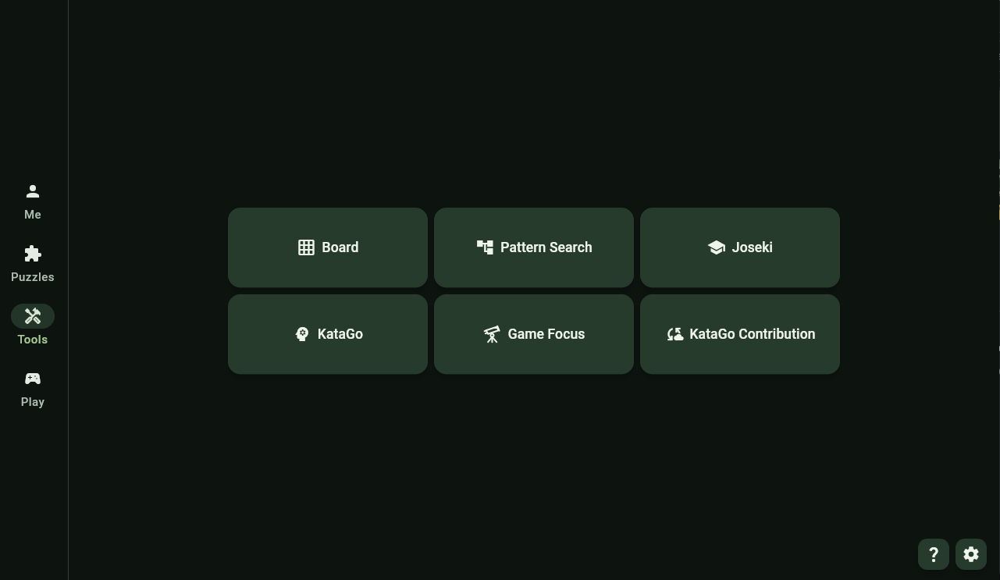
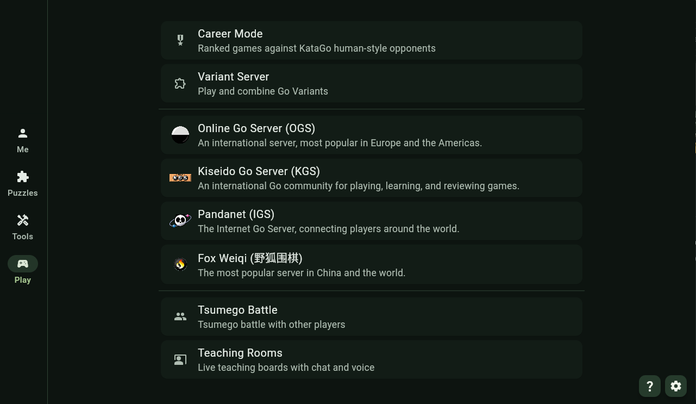

  <picture>
    <source media="(prefers-color-scheme: dark)" srcset="./Images/header_dark.png">
    
  </picture>

  <strong>Study, practise and play Go in one app.</strong> 
  Windows · Linux · macOS · Android

  
  
  
  

  <a href="#get-started">Get started</a> ·
  <a href="#cloud-katago">Free Cloud KataGo</a> ·
  <a href="#quick-answers">FAQ</a> ·
  <a href="CHANGELOG.md">Changelog</a>

SWHub is a personal Swiss army knife for **Go / Baduk / Weiqi**. To solve tsumego, analyse games with KataGo, build a study library and play online.

## A look inside

## Video

## Screenshots

<table width="100%">
  <tr>
    <td align="center" width="33%">
       
      <strong>Puzzles</strong> Reading practice and training modes
    </td>
    <td align="center" width="33%">
       
      <strong>Tools</strong> Analysis, review and study
    </td>
    <td align="center" width="33%">
       
      <strong>Play</strong> Online games and shared sessions
    </td>
  </tr>
</table>

Select a screenshot to view it at full size.

## Explore SWHub

| Destination | Find your next activity |
| --- | --- |
| **Puzzles** | Practise collections and topics, take exams, revisit mistakes with spaced repetition, save favourites, or try Breakthrough and Subjects. |
| **Tools** | Analyse with KataGo, review games and practise drills in Game Focus, explore Joseki, search Game Patterns, or study on a local board. |
| **Play** | Climb Career Mode, connect to OGS, KGS, Pandanet or FoxWQ, explore Variant Server, race through Tsumego Battles, or share a Teaching Room. |
| **Me** | Follow your progress, activity and personal bests, link playing profiles, and optionally sync training statistics. |

## A few highlights

- **Build your reading strength.** Grading and Endgame exams, Time Frenzy, adaptive Ranked Mode, custom exams and spaced repetition.
- **Try a new challenge.** Breakthrough mixes Best move and Who is ahead with 60-second puzzles. Subjects offers eight categories with kyu/dan progression and HumanSL opponents.
- **Learn from your games.** KataGo suggestions, score and win-rate graphs, variations and performance reports. Game Focus saves completed reviews for offline use and turns mistakes into drills.
- **Make a study library.** Edit SGFs, import a board photo, browse downloadable Joseki, and use Kombilo to search patterns across your own games.
- **Play at your pace.** Career Mode offers HumanSL opponents, random styles and an 18K–9D ladder. Online servers retain their own rules and controls.
- **Settle into your own layout.** Phone, tablet and desktop layouts, board themes, dark palettes, resizable panels and configurable shortcuts. Android tablets adapt when rotated, where space permits.

## Get started

1. **[Download SWHub](https://github.com/SoumyaK4/SWHub/releases/latest)** for Windows, Linux, macOS or Android.
2. **Choose a starting point.** Open Puzzles for reading practice, Tools for study, or Play for games. Puzzles and Joseki offer their data downloads when first opened. Installed data works offline, puzzle-data updates take effect after restarting SWHub.
3. **Set up KataGo when you need it.** Use desktop Auto Setup or connect a remote engine for analysis. Career and Subjects need both regular KataGo and HumanSL. The [cloud notebooks below](#cloud-katago) offer another way to get started.
4. **Find help inside the app.** Open **Settings → FAQ** or the **?** button for detailed feature guides. On desktop, **F1** opens shortcut search. Other app shortcuts are opt-in.

> **Android local KataGo is experimental.** Open **Settings → Local KataGo** to download and test it, then enable it. Local engine choices stay hidden until enabled. It compares downloaded CPU and compatible OpenCL GPU engines, with separate model downloads. Remote engine is always available.

On Linux, unlock your desktop keyring before opening SWHub. Saved server passwords use device secure storage and are not included in app backups.

## Cloud KataGo

Run KataGo remotely with the Colab or Modal notebooks, then connect SWHub to the engine.

| What you want to do | Google Colab | Modal |
| --- | --- | --- |
| **Play and analyse** | [Open notebook](./Docs/Free%20Cloud%20Katago/Analysis/Kata_Colab.ipynb) | [Open notebook](./Docs/Free%20Cloud%20Katago/Analysis/Kata_Modal.ipynb) |
| **Contribute to KataGo training** | [Open notebook](./Docs/Free%20Cloud%20Katago/Contribute/Kata_Colab_Contribution.ipynb) | [Open notebook](./Docs/Free%20Cloud%20Katago/Contribute/Kata_Modal_Contribution.ipynb) |

For Career and Subjects, HumanSL chooses opponent moves while regular KataGo supplies evaluations and related features. Cloud providers apply their own availability and usage limits.

## F.A.Q.

More detailed guides and controls are available in **Settings → FAQ** inside the app.

<strong>What works offline?</strong>

Downloaded puzzles and Joseki, Local Board, Pattern Search libraries, local statistics, saved SGFs and completed Game Focus reviews. Local KataGo also works offline after setup.

Subjects and Career needs a running KataGo engine. Using a remote engine requires internet, as do online play, cloud analysis, profile imports and sync.

<strong>Do I need an account? What does sync save?</strong>

Local training and file backups work without a sync username or key. Online servers use their own accounts. Server outages and sync quota limits do not stop local saving.

Optional statistics sync keeps your latest full training snapshot, including retained older history. It does not back up SGFs or your Game Focus and Pattern Search libraries, and it does not keep older backup versions.

**Cloud statistics backups expire after 365 days without a successful sync.** Your username, sync key, leaderboard history and local statistics remain. A current app can upload local stats again, but an expired cloud backup cannot be restored if you lose your device. Older apps need an update to sync after expiry.

Keep your existing username and key always securely saved somewhere because its needed when updating. Devices sharing a sync account need compatible app and puzzle-data versions.

<strong>How do I back up or move my data?</strong>

**On Android**, open **Settings → Backup and restore**. Statistics and Game Focus have separate exports:

| Backup | Includes | Restoring it |
| --- | --- | --- |
| **Statistics** | Training history, favourites, SRS, Subjects/Breakthrough progress, and your linked username and sync key. | Replaces local training statistics and account linkage. Keep the backup private. |
| **Game Focus ZIP** | All profiles, the selected profile, accounts, imported games, saved analysis, drills and review history. | Validates the archive, then replaces the entire local Game Focus library. Close Game Focus first. Training statistics are unaffected. |

**On desktop**, close SWHub before copying data then backup everything from `Documents/SWHub`.

**App settings and Career progress** cannot be backed up.

<strong>How do Breakthrough and Subjects work?</strong>

**Breakthrough:** alternate Best move and Who is ahead, with 60 seconds per puzzle and three failures per run. The leaderboard records your highest level. Its puzzles stay outside regular puzzle totals, search, favourites and SRS.

**Subjects:** solve puzzles in order and finish every puzzle in a rank to unlock the next. You have three 60-second byo-yomi periods. Pass with at least 90% estimated human win rate after 40 additional moves counting both players, or after both players pass in Endgame. Attempts and unlocks save locally, with optional sync. Subjects has no leaderboard.

Subjects results and pass rates appear in **Statistics → Charts** under **Subject**, with category results under **By type → Subjects**. Subjects is not included in Recent.

<strong>FoxWQ?</strong>

Open **Play → FoxWQ** and sign in with your Fox account. The bundled client connects directly. Browse players and broadcasts, play, chat, and review or download game records.

Controls follow the app language, while player messages keep their original text. Small screens use bottom navigation and an overflow menu in the lobby, with the bar hidden inside rooms. Wide screens use a feature rail. See **Settings → FAQ → Play Page → FoxWQ** for detailed guidance.

If a connection fails during a game, Fox tries to reconnect up to four times while keeping the last confirmed board visible. If recovery fails, you return to Play.

This is an unofficial FoxWQ Client. Server compatibility and account safety cannot be guaranteed. Consider using a spare account.

<strong>How do Teaching Rooms and Tsumego Battles work?</strong>

**Teaching Rooms** gives you shared boards, chat and voice. Enter the access password once on your device, then create or join a room. Studies preserve imported SGF metadata, comments, markers and the selected player to move. Teachers can let selected students play or use voice.

Teaching rooms close after the teacher has been absent for five minutes.

**Tsumego Battles** lets participants solve the same puzzle set together. Rejoin the same room to reconnect while it remains available. Battle rooms expire after everyone disconnects.

Keep SWHub up to date on every participant's device for compatible results, shared boards and voice.

<strong>Where are the controls, and how do updates work?</strong>

Use **Settings → FAQ** for feature guides and mouse gestures, and **Settings → Keyboard shortcuts** for bindings. **F1** opens shortcut search on desktop. Mouse-wheel navigations work independently of enabled keyboard bindings where supported.

SWHub checks for updates on every app launch. You can read release notes before downloading or use the [releases page](https://github.com/SoumyaK4/SWHub/releases) to update manually. Installation uses your platform's normal confirmation or replacement flow.

## Community

- Report any issues/requests **[here](https://github.com/SoumyaK4/SWHub/issues)** or **[Discord](https://discord.gg/ptjzTWU9SP)** with the steps to reproduce it and your platform.
- **[Computer Go Community](https://discord.gg/5aTGusWxvc)** KataGo related discussion.
- Other **[Go projects](https://soumyak4.in/)** by Me.

## Puzzle reminder for myself

Add solution moves for tasks **162032–162121** in
**Troublesome** and **Diabolical** (90 puzzles), then publish updated puzzle data.

## License

SWHub is proprietary software, it is not open source. Just me being petty so people with their AI pets have to spend more moni doing anything. The [SWHub Non-Commercial Proprietary License](LICENSE.md) prohibits unauthorized commercial use, monetization, modification, builds and redistribution. [Third-party components](./Docs/Licenses) retain their own terms.

Get official copies from SoumyaK4 or the [official releases](https://github.com/SoumyaK4/SWHub/releases). Third-party mirrors, stores and re-uploads are not authorized. SWHub source code is not included in the public distribution or licensed for use.
